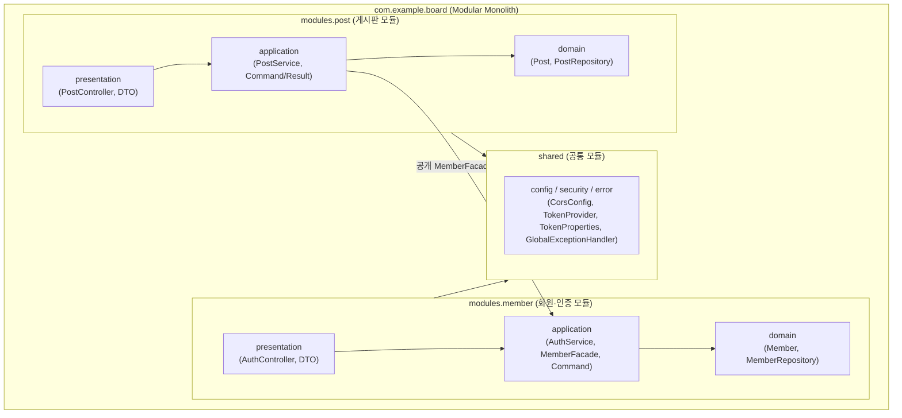
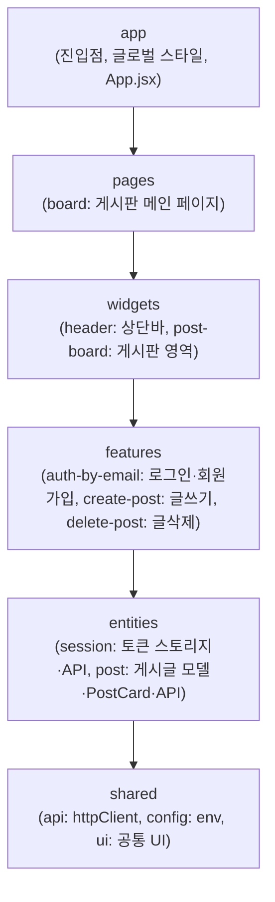

# 풀스택 게시판 Railway 배포 실습 설계서 (Design & Plan)

## 1. 시스템 및 소프트웨어 아키텍처

### 1.1 인프라 아키텍처 (1 GitHub Repo → Railway 3 Services)
하나의 GitHub 모노레포(`backend/`, `frontend/`)를 Railway의 단일 Project 내 **3개 서비스(PostgreSQL DB + Backend + Frontend)** 로 분리 배포하고 서비스 간 환경변수 및 참조 변수로 연결합니다.

```mermaid
flowchart LR
    subgraph Railway["Railway Project (단일 프로젝트 내 3개 서비스)"]
        direction LR
        FE["Frontend Service<br/>(Root: /frontend)<br/>React + Vite (FSD) + Nginx"]
        BE["Backend Service<br/>(Root: /backend)<br/>Spring Boot 3 (Modular Monolith)"]
        DB[("PostgreSQL Plugin<br/>(Railway Managed DB)")]
    end

    User["사용자 브라우저"] -->|HTTPS| FE
    User -->|REST API 요청<br/>VITE_API_URL| BE
    BE -->|CORS 허용<br/>CORS_ALLOWED_ORIGINS| User
    BE -->|Railway 참조 변수 연결<br/>${{Postgres.PG*}}| DB
```

### 1.2 백엔드 아키텍처: 모듈러 모놀리스 (Modular Monolith)
단일 Spring Boot 배포 단위를 유지하면서 도메인(`member`, `post`) 간 경계를 명확히 분리합니다.
- **모듈 경계 및 계층 분리 규칙**:
  - 각 도메인 모듈은 내부적으로 `domain` (엔티티·리포지토리), `application` (서비스·커맨드/쿼리 모델), `presentation` (컨트롤러·DTO) 계층을 가집니다.
  - **계층 역방향 의존 금지**: `application` 계층은 `presentation` 계층의 DTO를 절대 참조하지 않습니다. 컨트롤러가 HTTP DTO를 `application`의 Command 객체로 변환하여 전달하고, 서비스는 도메인/Result 객체를 반환하며 컨트롤러가 이를 응답 DTO로 매핑합니다.
  - **인증 분리 및 헤더 누락 처리**: 컨트롤러는 `@RequestHeader(value = HttpHeaders.AUTHORIZATION, required = false)`로 헤더를 수신합니다. 헤더가 누락되었거나 Bearer 형식이 잘못된 경우 `TokenProvider`가 명확한 `401 Unauthorized` 예외(`ApiException`)를 발생시키며, 서비스에는 유효성이 검증된 `Long memberId`를 직접 전달합니다.
  - **`post` 모듈 격리**: `post` 모듈은 `member` 모듈의 `Member` 엔티티를 직접 참조(JPA 연관관계 강결합)하지 않고, 작성자 식별자(`authorId`) 및 공개된 `MemberFacade` 인터페이스를 통해서만 회원 정보를 검증·조회합니다.



### 1.3 프론트엔드 아키텍처: FSD (Feature-Sliced Design)
단방향 의존성 규칙(`app` → `pages` → `widgets` → `features` → `entities` → `shared`)을 준수하는 **Feature-Sliced Design** 구조를 적용합니다.



---

## 2. 도메인 및 데이터 모델 (ERD)

모듈러 모놀리스 원칙에 따라 `posts` 테이블은 `members` 엔티티와 물리적 객체 참조 대신 `author_id` (논리적 FK)와 작성 시점 `author_nickname` 스냅샷을 보관합니다.

### 2.1 `Member` (`member` 모듈 — 테이블: `members`)
- **유니크 제약명 명시**: `uk_members_email` (동시 가입 제약 위반 시 안전한 409 변환 보장)

| 컬럼명 | 타입 | 제약조건 | 설명 |
| :--- | :--- | :--- | :--- |
| `id` | `BIGINT` | PK, Auto Increment | 회원 고유 식별자 |
| `email` | `VARCHAR(120)` | Unique (`uk_members_email`), Not Null | 로그인 이메일 (소문자 정규화) |
| `password_hash` | `VARCHAR(255)` | Not Null | BCrypt 해시 암호화된 비밀번호 |
| `nickname` | `VARCHAR(50)` | Not Null | 게시글에 표시될 닉네임 (2~50자) |
| `created_at` | `TIMESTAMP` | Not Null | 가입 일시 |

### 2.2 `Post` (`post` 모듈 — 테이블: `posts`)
| 컬럼명 | 타입 | 제약조건 | 설명 |
| :--- | :--- | :--- | :--- |
| `id` | `BIGINT` | PK, Auto Increment | 게시글 고유 식별자 |
| `title` | `VARCHAR(150)` | Not Null | 게시글 제목 (1~150자) |
| `content` | `TEXT` | Not Null | 게시글 본문 (1자 이상) |
| `author_id` | `BIGINT` | Not Null (Index) | 작성자 회원 ID (`member` 식별자 참조) |
| `author_nickname` | `VARCHAR(50)` | Not Null | 작성 시점 작성자 닉네임 스냅샷 |
| `created_at` | `TIMESTAMP` | Not Null | 작성 일시 |

---

## 3. REST API 명세 및 페이징 계약 (Backend)

### 3.1 페이징 응답 공통 스키마 (`PageResponse<T>`)
```json
{
  "items": [ ... ],
  "page": 0,
  "size": 10,
  "totalElements": 25,
  "totalPages": 3,
  "first": true,
  "last": false
}
```
- **페이징 파라미터 유효성 검증**:
  - `page >= 0`: 0 이상의 정수 (음수 입력 시 `400 Bad Request`)
  - `1 <= size <= 50`: 1 이상 50 이하 (0 또는 음수 입력 시 `400 Bad Request`, 50 초과 시 50으로 자동 보정)

### 3.2 엔드포인트 목록

| 소속 모듈 | Method | URI | 인증 필요 | 파라미터 / 바디 | 응답 | 설명 |
| :--- | :---: | :--- | :---: | :--- | :--- | :--- |
| `shared` | `GET` | `/actuator/health` | X | - | `{"status":"UP"}` | Railway 헬스체크 엔드포인트 |
| `member` | `POST` | `/api/auth/signup` | X | `SignupRequest` (`email` 120자, `password` 8~64자, `nickname` 2~50자) | `201 Created` (`accessToken`, `member`) | 이메일 정규화, 중복 방지(`uk_members_email`) 및 토큰 발급 |
| `member` | `POST` | `/api/auth/login` | X | `LoginRequest` (`email`, `password`) | `200 OK` (`accessToken`, `member`) | 비밀번호 검증 후 토큰 발급 |
| `member` | `GET` | `/api/auth/me` | O (`Bearer`) | - | `200 OK` (`member`) | 현재 로그인한 회원 정보 반환 |
| `post` | `GET` | `/api/posts` | X | `page` (기본 0), `size` (기본 10) | `200 OK` (`PageResponse<PostListItemResponse>`, **`authorId` 포함**, 본문 제외) | 전체 게시글 최신순 요약 목록 조회 |
| `post` | `GET` | `/api/posts/{id}` | X | - | `200 OK` (`PostDetailResponse`, 본문 포함) | 특정 게시글 상세 조회 |
| `post` | `POST` | `/api/posts` | O (`Bearer`) | `PostCreateRequest` (`title` 1~150자, `content` 1자 이상) | `201 Created` (`PostDetailResponse`) | 새 게시글 등록 (`MemberFacade`로 작성자 검증) |
| `post` | `DELETE` | `/api/posts/{id}` | O (`Bearer`) | - | `204 No Content` | 작성자 본인(`authorId`) 확인 후 게시글 삭제 |

> **중요 (프론트엔드 삭제 버튼 연동)**:
> `PostListItemResponse`에 `authorId`를 포함하여 반환함으로써, 프론트엔드가 목록 화면에서 `currentMember?.id === post.authorId` 조건으로 본인 글에만 삭제 버튼을 렌더링할 수 있도록 보장합니다.

---

## 4. 디렉토리 구조 (Modular Monolith + FSD)

```text
Railway_pratice/
├── README.md                                  # Railway 풀스택(DB+BE+FE) 단계별 배포 실습 가이드
├── context/
│   ├── requirements.md                        # 프로젝트 요구사항 정의서
│   ├── design.md                              # 아키텍처 및 실습 설계서 (현재 문서)
│   ├── feedback/                              # 설계 검토 및 피드백 기록 (feedback0.md, feedback1.md)
│   └── tasks/                                 # 작업 단위별 상세 구현 계획서 (task0.md ~ task7.md)
├── backend/                                   # Spring Boot 3 (Java 21) — Modular Monolith
│   ├── Dockerfile
│   ├── build.gradle
│   └── src/main/
│       ├── java/com/example/board/
│       │   ├── BoardApplication.java
│       │   ├── shared/                        # [공통 모듈] 설정, 보안/토큰, 공통 예외 처리
│       │   │   ├── config/
│       │   │   │   ├── CorsConfig.java
│       │   │   │   └── SecurityBeansConfig.java
│       │   │   ├── security/
│       │   │   │   ├── TokenProperties.java   # Environment 기반 prod 프로필 검증
│       │   │   │   └── TokenProvider.java
│       │   │   ├── error/
│       │   │   │   ├── ApiException.java
│       │   │   │   └── GlobalExceptionHandler.java
│       │   │   └── response/
│       │   │       └── PageResponse.java      # 페이징 공통 응답 레코드
│       │   └── modules/
│       │       ├── member/                    # [회원·인증 도메인 모듈]
│       │       │   ├── domain/
│       │       │   │   ├── Member.java        # uk_members_email 유니크 제약명 명시
│       │       │   │   └── MemberRepository.java
│       │       │   ├── application/
│       │       │   │   ├── MemberInfo.java
│       │       │   │   ├── MemberFacade.java  # 타 모듈(post)에 공개되는 인터페이스
│       │       │   │   ├── AuthService.java
│       │       │   │   └── command/
│       │       │   │       ├── SignupCommand.java
│       │       │   │       └── LoginCommand.java
│       │       │   └── presentation/
│       │       │       ├── AuthController.java
│       │       │       └── dto/
│       │       │           ├── SignupRequest.java
│       │       │           ├── LoginRequest.java
│       │       │           └── AuthResponse.java
│       │       └── post/                      # [게시판 도메인 모듈]
│       │           ├── domain/
│       │           │   ├── Post.java
│       │           │   └── PostRepository.java
│       │           ├── application/
│       │           │   ├── PostService.java
│       │           │   └── command/
│       │           │       └── CreatePostCommand.java
│       │           └── presentation/
│       │               ├── PostController.java
│       │               └── dto/
│       │                   ├── PostCreateRequest.java
│       │                   ├── PostListItemResponse.java  # authorId 포함, 본문 제외
│       │                   └── PostDetailResponse.java    # 본문 포함
│       └── resources/
│           └── application.yml                # local(H2) / prod(PostgreSQL) 프로필 분리
└── frontend/                                  # React (Vite) — Feature-Sliced Design (FSD)
    ├── Dockerfile
    ├── nginx.conf.template                    # SPA 라우팅 및 동적 PORT 바인딩 설정
    ├── package.json
    └── src/
        ├── main.jsx
        ├── app/                               # [app 레이어] 앱 초기화 및 전역 스타일
        │   ├── App.jsx
        │   └── styles/
        │       └── index.css
        ├── pages/                             # [pages 레이어] 라우트 페이지 단위 조합
        │   └── board/
        │       ├── ui/
        │       │   └── BoardPage.jsx
        │       └── index.js
        ├── widgets/                           # [widgets 레이어] 헤더·게시판 등 독립 위젯 블록
        │   ├── header/
        │   │   ├── ui/
        │   │   │   └── HeaderWidget.jsx
        │   │   └── index.js
        │   └── post-board/
        │       ├── ui/
        │       │   └── PostBoardWidget.jsx
        │       └── index.js
        ├── features/                          # [features 레이어] 사용자 액션·유스케이스
        │   ├── auth-by-email/
        │   │   ├── ui/
        │   │   │   └── AuthForm.jsx
        │   │   └── index.js
        │   ├── create-post/
        │   │   ├── ui/
        │   │   │   └── CreatePostForm.jsx
        │   │   └── index.js
        │   └── delete-post/
        │       ├── ui/
        │       │   └── DeletePostButton.jsx
        │       └── index.js
        ├── entities/                          # [entities 레이어] 도메인 모델·상태·API
        │   ├── session/
        │   │   ├── api/
        │   │   │   └── authApi.js
        │   │   ├── model/
        │   │   │   └── sessionStorage.js
        │   │   └── index.js
        │   └── post/
        │       ├── api/
        │       │   └── postApi.js
        │       ├── ui/
        │       │   └── PostCard.jsx
        │       └── index.js
        └── shared/                            # [shared 레이어] 공통 API 클라이언트·환경변수·UI
            ├── config/
            │   └── env.js
            └── api/
                └── httpClient.js
```

---

## 5. Railway 배포 핵심 설계 포인트

1. **대시보드 기반 설정 공식 가이드 적용**:
   - `railway.json` / `railway.toml`이 deprecated됨에 따라 배포 설정은 **Railway 대시보드 UI**를 기준으로 구성
   - Backend 서비스: Railway Dashboard → Settings → Root Directory를 `/backend`로 설정, Healthcheck Path를 `/actuator/health`로 지정
   - Frontend 서비스: Railway Dashboard → Settings → Root Directory를 `/frontend`로 설정
2. **동적 포트(`PORT`) 바인딩**:
   - Backend (`application.yml`): `server.port: ${PORT:8080}`
   - Frontend (`nginx.conf.template`): 컨테이너 시작 시 Railway가 주입하는 `${PORT}`로 Nginx 리스닝 포트 동적 치환
3. **환경(Profile) 및 DB 연결 분리**:
   - `local` 프로필(기본): 인메모리 H2 DB 사용으로 로컬에서 즉시 실행·테스트 가능, 기본 개발 시크릿 허용
   - `prod` 프로필(Railway):
     - `SPRING_PROFILES_ACTIVE=prod`
     - **복수 프로필 지원 운영 시크릿 검증**: `Environment.acceptsProfiles(Profiles.of("prod"))`로 판정하여 `prod` 포함 시 `AUTH_SECRET` 누락/빈문자열/기본키 기동 차단
     - **Railway 변수 참조 문법 적용**:
       - `PGHOST=${{Postgres.PGHOST}}`
       - `PGPORT=${{Postgres.PGPORT}}`
       - `PGDATABASE=${{Postgres.PGDATABASE}}`
       - `PGUSER=${{Postgres.PGUSER}}`
       - `PGPASSWORD=${{Postgres.PGPASSWORD}}`
4. **프론트↔백엔드 도메인 및 CORS 연동**:
   - Frontend 빌드 환경변수: `VITE_API_URL=https://<백엔드-도메인>`
   - Backend 환경변수: `CORS_ALLOWED_ORIGINS=https://<프론트엔드-도메인>`

---

## 6. 논리 단위 작업 및 커밋 계획 (`staged-commit-workflow`)

문서 단계(Task 0)와 실제 코드 구현 단계(Task 1~7)를 명확한 논리 단위로 분리하여 진행합니다.

| 순서 | 논리 단위 작업 내용 | 예정 커밋 메시지 |
| :--- | :--- | :--- |
| **단위 0** | 피드백 반영 완료된 요구사항, 아키텍처 설계서 및 태스크 상세 계획 문서화 | `docs: 피드백 반영 요구사항, 설계서 및 작업 계획 문서 최신화` |
| **단위 1** | 백엔드 프로젝트 초기 설정 및 `shared` 공통 모듈(`Environment` 기반 시크릿 검증, 제약 식별 DB 예외 핸들러, `PageResponse`) 구성 | `chore: 백엔드 빌드 설정 및 공통 모듈 구성` |
| **단위 2** | 백엔드 `member` 도메인 모듈(Command/Entity 분리, `uk_members_email` 유니크 제약, `MemberFacade`) 구현 | `feat: 회원 도메인 모듈 및 이메일 인증 API 구현` |
| **단위 3** | 백엔드 `post` 도메인 모듈(페이징 유효성 검증, `authorId` 포함 목록/상세 DTO 분리, 닉네임 스냅샷) 구현 | `feat: 게시판 도메인 모듈 및 페이징 CRUD API 구현` |
| **단위 4** | 백엔드 모듈러 모놀리스 통합 테스트(복수 프로필 시크릿 검증, 실제 동시 가입 경합, 페이징 계약, 권한 오류 검증) | `feat: 회원 인증 및 게시판 모듈 통합 테스트 추가` |
| **단위 5** | 프론트엔드 React(Vite) 초기 설정 및 FSD `shared`·`entities` 레이어 구성 | `chore: 프론트엔드 FSD 기본 구조 및 shared·entities 레이어 구성` |
| **단위 6** | 프론트엔드 FSD `features`·`widgets`·`pages`·`app` 레이어 화면 구현 (페이징 네비게이션 및 `npm run build` 검증) | `feat: FSD features·widgets·pages·app 레이어 화면 구현` |
| **단위 7** | Railway 멀티 서비스 배포 설정(`Dockerfile`, `nginx.conf.template`) 및 단계별 실습 가이드 작성 | `docs: 풀스택 Railway 배포 설정 및 단계별 실습 가이드 작성` |
